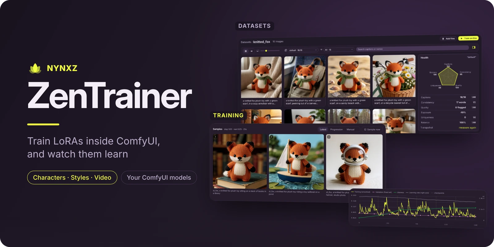
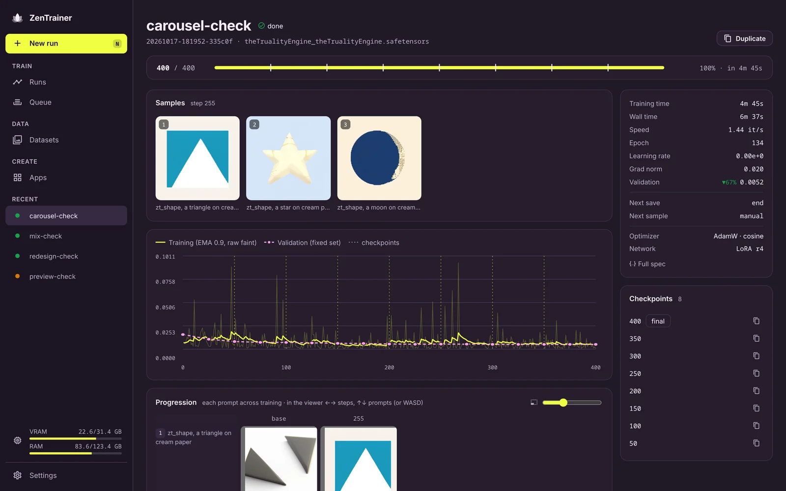
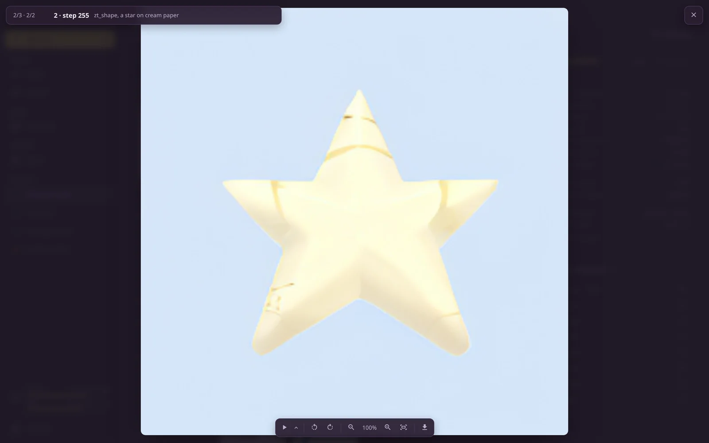
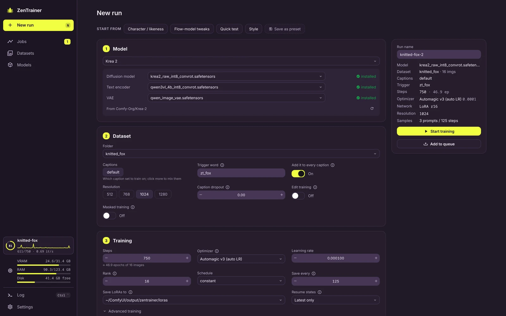
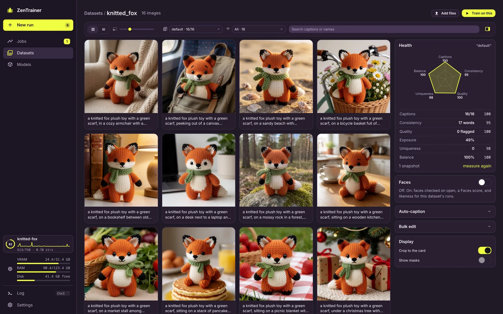
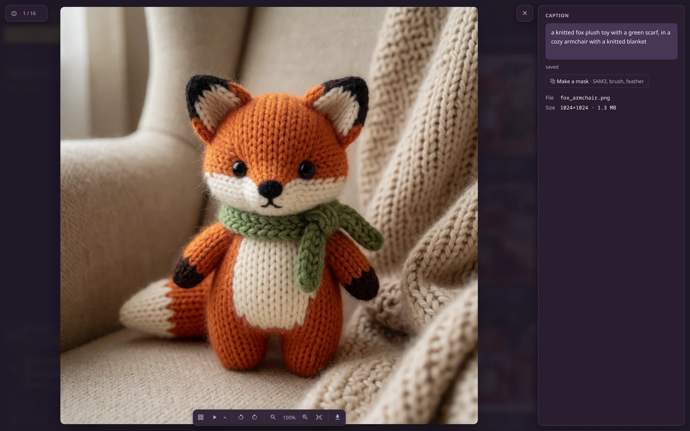
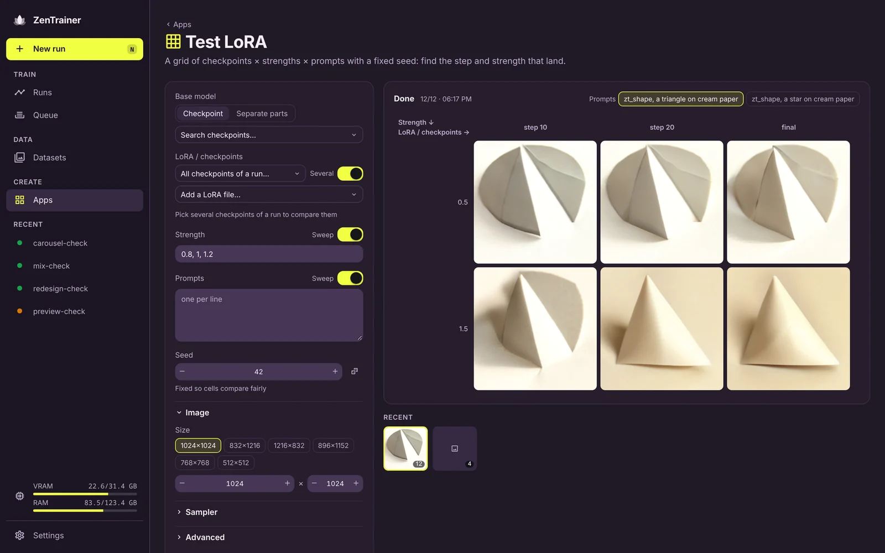

Train LoRAs and run your workflows in one app, with ComfyUI doing the work underneath. Nothing new
to download: it uses the models and the GPU your ComfyUI already has, and it trains on ComfyUI's
own model code, so whatever ComfyUI can load, you can train.

## Training you can watch

Every run gets one page: the newest sample for each prompt beside the loss, and the numbers that
matter in a rail on the right. While a sample renders you see it denoise in its tile. Notches on
the bar mark each checkpoint and sample, so you know what's coming and when.

- **Pause, sample now, save now, change the learning rate**, all mid-run
- **Resume** a stopped or crashed run from any checkpoint, optimizer state and all
- **Validation loss** on a fixed set, so the curve only moves when the LoRA does
- **Training time apart from total time**, so loading models and sampling don't make a run look slow
- **A queue on the Runs page**: line runs up, reorder them, and they train one after another



## Samples as a grid

Every prompt across every step. In the viewer ←/→ (or A/D) moves through training, ↑/↓ (or W/S)
switches prompt, so you can watch one prompt learn and then check the others at the same step.
Wheel to zoom, drag to pan.



## Set up a run

Pick a model by name (Krea 2, Z-Image, Qwen-Image, SDXL…) and every part is filled in: the
base build to train on, its text encoder and VAE, each marked installed or one click from
downloading off its Comfy-Org Hugging Face repo. The family's turbo build is offered for fast
previews, with the sampler settings ComfyUI's own template uses. The **Models** page lists
every family, what you have of it, and the rest.

Start from a preset (Character, Style, Flow-model tweaks, Quick test) or one of your own, and the
form warns you about what usually goes wrong: no trigger word, sample prompts that never use it, a
learning rate the optimizer won't like, too few epochs.

- **Trigger word** added to every caption, and `[trigger]` in captions and prompts
- **Optimizers**: AdamW, Prodigy, Lion, Adafactor, CAME, schedule-free, 8-bit and more, each with a suggested learning rate
- **LoRA, LoHa, LoKr or OFT**; masked training; caption dropout; mixed caption sets
- **Sample with another model**: train on the raw base, preview on its turbo version



## Datasets

Any folder in ComfyUI's `input/` is a dataset. Browse it as a grid or a table and edit captions in
place. Click an image to open it big, with its caption beside it and its training mask overlaid.

- **Caption sets**: keep long and short captions side by side and train on either, or a mix
- **Auto-caption** with a vision model through ComfyUI's own text generation (Qwen-VL, Gemma)
- **Bulk edits**: prefix, suffix or find and replace across a set
- **Masks**: drop `name-masklabel.png` beside an image and it learns only where the mask is white





## Apps

ComfyUI workflows with an interface built for the job. **Test LoRA** renders checkpoints ×
strengths × prompts on a fixed seed, so you can see which step and which strength actually land.
**Generate** is a clean txt2img on any model, with your LoRAs.

An app is a small manifest plus a workflow, bound by node titles. Apps can extend each other, so an
inpainting app is Generate with a mask input added. → [Writing apps](docs/APPS.md)



## Your ComfyUI, kept safe

ZenTrainer runs on its own pinned copy of ComfyUI, so updating your main install or its custom
nodes can't break a training run. Your models stay where they are, read through
`extra_model_paths.yaml`. Themes come from [ZenKit](https://github.com/Nynxz/ZenKit), so it matches
the rest of your setup.

## Run it

```sh
scripts/zt setup --models-from /path/to/your/ComfyUI   # clone pinned ComfyUI, install, link the engine
scripts/zt start --open                                # http://127.0.0.1:8189/zentrainer/
scripts/zt dev                                         # ComfyUI + web app with hot reload (:5173/zentrainer/)
scripts/zt restart                                     # restart ComfyUI (picks up engine changes)
scripts/zt doctor                                      # what's installed, where models come from
```

`--models-from` takes an existing ComfyUI install (its `models/` and its
`extra_model_paths.yaml`) or a plain models folder. To point at a yaml directly, use
`--extra-model-paths /path/to/extra_model_paths.yaml`. Both flags are repeatable and
can be combined. Or skip the flags and drop (or symlink) an `extra_model_paths.yaml`
into `comfyui/`: ComfyUI loads that file on its own.

Datasets go in `comfyui/input/<name>/`; trained LoRAs land in
`comfyui/output/zentrainer/loras/`. Theme packs are bundled; `--zenkit` is optional.

Prefer one ComfyUI? `scripts/zt attach /path/to/ComfyUI` links the engine into it
instead. It works as long as that ComfyUI is close to the pin in `comfy.lock`.

`comfy.lock` pins the ComfyUI commit and torch build that the harness is tested
against. The harness uses ComfyUI internals, so move the pin with
`scripts/zt update --ref <commit|tag>` and test before committing it.

## How it works

The training loop is ZenTrainer's own: it loads models, patches in the LoRA and steps the
optimizer with ComfyUI as a library, not through workflows. While a run trains, a one-node job holds
ComfyUI's queue, so a generation can't land on the GPU mid-step. Design and rationale are in
[docs/ARCHITECTURE.md](docs/ARCHITECTURE.md).

```
engine/   ComfyUI node pack: training harness (ComfyUI as a library), run API, session node
web/      Vue app (zenkit-ui, ZenKit themes), served by ComfyUI at /zentrainer/
tests/    harness tests that need no ComfyUI
scripts/  zt (setup, start, dev, …); devrun.py runs a spec through the harness without the server
docs/     architecture, apps; banner/ holds the README banner's source
```

## Develop

`scripts/zt dev` is the loop: web edits hot-reload at http://localhost:5173/zentrainer/,
engine (Python) edits need `scripts/zt restart` (or Restart on the System page).

```sh
# tests (no GPU)
uv run --with pytest --with torch --with pillow --with numpy --no-project python -m pytest

# a spec straight through the harness, using ComfyUI as a library (see examples/)
comfyui/.venv/bin/python scripts/devrun.py examples/sdxl-quick.json --comfy comfyui

# README banner (docs/banner/banner.html → docs/images/banner.webp)
uv run --with playwright --with pillow --no-project python docs/banner/render.py
```
